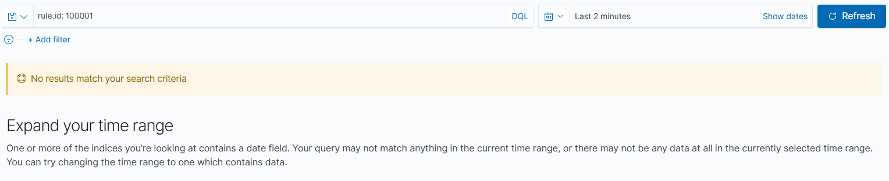

# T1053.005: Scheduled Task/Job (Scheduled Task)

**Tactic:** Persistence (also Execution, Privilege Escalation) | **ATT&CK:** https://attack.mitre.org/techniques/T1053/005/

## Why it matters
Scheduled tasks survive reboots and can run as SYSTEM, making them a common persistence mechanism.

## Simulation
```powershell
schtasks /create /tn "WindowsUpdateCheck" /tr "powershell.exe -WindowStyle Hidden -Command Write-Host Persistence_Test" /sc onlogon /ru SYSTEM
```
The task name imitates a legitimate Windows task, which is a common masquerading trick. Cleanup:
```powershell
schtasks /delete /tn "WindowsUpdateCheck" /f
```

## Before: the gap
The command ran successfully (confirmed locally), but nothing appeared in Wazuh Discover. Sysmon logged the process creation, but no default rule matched it, and Wazuh only indexes events that match a rule.

Evidence: `evidence/T1053.005-before-zero-hits.png` (`rule.id: 100001` returns 0 hits)

## Detection: custom rule 100001
```xml
<rule id="100001" level="10">
  <if_group>sysmon_event1</if_group>
  <field name="win.eventdata.image">schtasks.exe</field>
  <description>Suspicious scheduled task creation detected via schtasks.exe</description>
  <mitre><id>T1053.005</id></mitre>
</rule>
```
- **Logic:** fires on any Sysmon process-creation event whose image is `schtasks.exe`.
- **Level 10:** high enough to stand out, since persistence is a serious tactic.

## After: validated
Re-running the command produced 1 hit for `rule.id: 100001`, with lineage back to `powershell.exe` run as Administrator.
Evidence: `evidence/T1053.005-after-alert.png`

## False positives
The rule matches **every** `schtasks.exe` execution, including queries (`/query`) and legitimate admin or software-installer activity. The description says "creation," but the logic does not check that.

## Gaps and tuning ideas
- Match on the command line containing `/create` so queries and deletions don't alert.
- Raise severity when the task runs as SYSTEM or uses hidden window flags.
- Does not cover tasks created without `schtasks.exe` (PowerShell `Register-ScheduledTask`, COM, direct API). Consider also monitoring Security events 4698 (task created).
