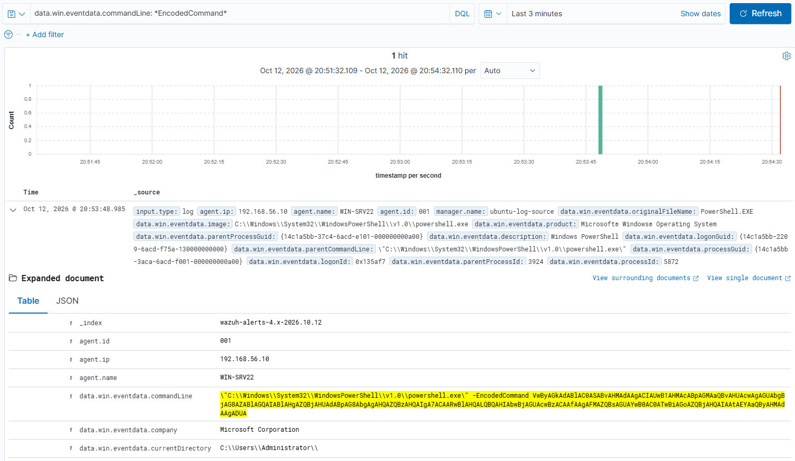

# T1059.001: PowerShell (Encoded Command)

**Tactic:** Execution | **ATT&CK:** https://attack.mitre.org/techniques/T1059/001/

## Why it matters
Attackers use `-EncodedCommand` to hide script content from casual inspection and from simple command-line filters.

## Simulation
```powershell
$cmd = 'Write-Host "Suspicious encoded execution test"; Get-Process | Select-Object -First 5'
$bytes = [System.Text.Encoding]::Unicode.GetBytes($cmd)
$encoded = [Convert]::ToBase64String($bytes)
powershell.exe -EncodedCommand $encoded
```
The payload is benign; only the delivery pattern is suspicious.

## Telemetry
Sysmon Event ID 1 (process creation) with the full command line, parent process, parent command line, and logon ID.

## Detection
Matched an **existing default Wazuh rule** for `-EncodedCommand`, so no custom rule was needed.
Rule ID: `<fill in from your Discover screenshot>`

## Result
Detected out of the box, with full process lineage captured.


## False positives
Legitimate management and deployment tools sometimes use encoded commands.

## Gaps
Attackers can obfuscate in other ways (string concatenation, environment variables, alternate flags such as abbreviated `-enc`) that a single default rule may not cover. Worth testing in v2.
